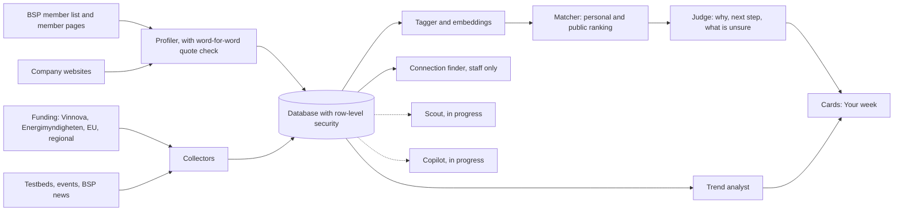

# Virtual Science Park: how it works

Every Blue Science Park member gets a short, ranked list of funding calls,
testbeds, events and partners that may fit it this week, with the source of
every line. Facts and numbers below are from the repo and the database on
14 November 2026.

## Sources

- **Members:** BSP's member list and member pages (56 members), and each
  member's own website.
- **Funding:** Vinnova's open data API, Energimyndigheten's call list, the EU
  Funding & Tenders search, and regional funding (Region Blekinge, Almi,
  Interreg South Baltic) entered by hand.
- **Testbeds, events, news:** a curated testbed list entered by hand, Tech
  Concept Lab's events, BSP and MTC event series entered by hand, BSP news.

Anything entered by hand is labelled "simulated" in the app. Each live source
keeps a recorded copy, used when the source is down.

## The agents

The models are NVIDIA's free API (`nvidia/nemotron-3.5-lightning-30b-a3b`)
and Voyage AI embeddings.

- **Collectors** read each source every night. No model.
- **Profiler** reads a member's home page and BSP member page and writes eight
  profile fields. Every quote is checked word for word against the stored page
  text. A field whose quotes fail gets one retry; if it fails again it is
  stored as "missing", never as an unproven claim.
- **Tagger** marks each text with six areas (marine, defence, sensor, cyber,
  AI, energy). Embeddings turn profiles and opportunities into vectors.
- **Matcher** ranks opportunities per member in one SQL statement, from five
  weighted parts. It has two modes: **personal** uses the member's private
  priorities and feedback; **public** uses public data only and is what staff
  see. The top 20 per mode are stored.
- **Judge** reads the profile and the ranked matches and writes why each one
  fits, a next step for this week and what is unsure, or rejects it.
- **Cards** (no model) pick up to six judged matches and one trend note a week
  for the "Your week" screen.
- **Trend analyst** writes one note per technology area a week from news and
  new calls. Every date, amount and funder in a note must appear in a cited
  source.
- **Connection finder** (staff only) suggests pairs of members with a concrete
  reason to talk, citing public claims from both. It never says a company is
  interested.
- **Scout** (in progress): a short research brief on a question, where every
  option cites a source the run found.
- **Copilot** (in progress): a chat that answers from the store only, cites
  its sources and hands questions to BSP staff.

## Privacy

The database decides who sees what, through row-level security; prompts do
not. Each sign-in carries the user's role and company, which users cannot
change. Public BSP data is readable by any signed-in user. Private claims,
priorities, personal matches, feedback, saved items, chats and Scout briefs
are readable only by the company itself. Staff read public data, public
matches and questions sent to them, and never read chats.

## Keeping profiles current

The collectors and the ranking are scheduled every night and the profile
refresh every Monday (a scheduled run has not yet been seen in the run
history: open). A page that has not changed costs no model call.
A field that has changed becomes a **suggested update** for the member to
accept or reject; the old claim stays until then. A claim older than 90 days
counts as stale.

## What it never does

- It never decides eligibility. The only verdict it gives is "potential
  match"; checks in code refuse words such as "eligible" or "qualifies".
- It never stores a profile fact without a quote found on the company's page.
- It never shows one member's private data to another member or to staff.
